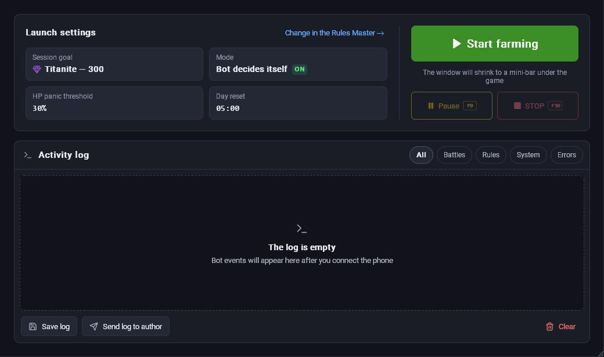
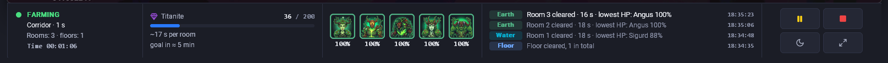
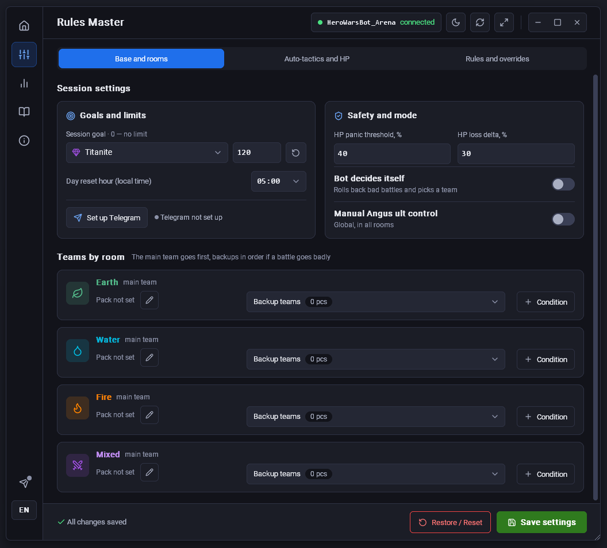
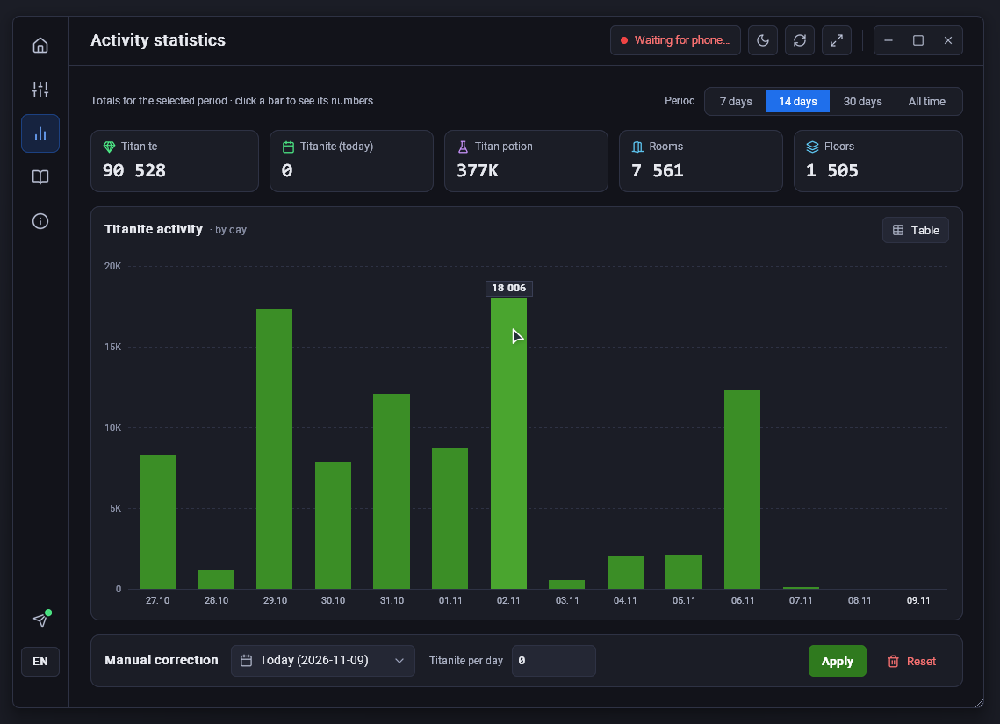
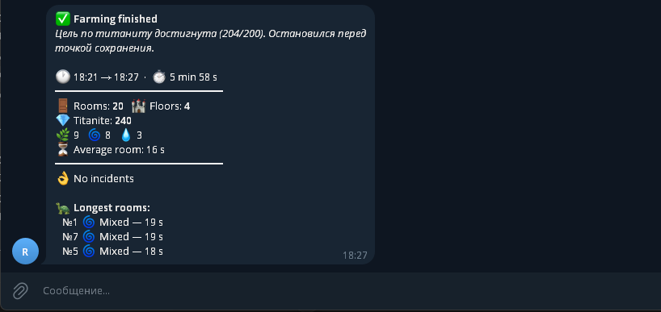

# DungeonBot

**DungeonBot** is a learning RPA (robotic process automation) project. It plays **one location** of the mobile game
*Hero Wars* — the Titan **Dungeon** — on an Android phone connected to a Windows PC. It watches the phone screen
mirrored by [scrcpy](https://github.com/Genymobile/scrcpy), reads Titans' health and energy, picks a team by your rules,
judges every battle and taps through ADB. The rest of the game it does not touch.

The program window is called **Hero Wars: Knowledge Engine Bot**.

> ### ⚠️ Educational project / Учебный проект
> This project was made **for learning and for testing code**: computer vision, state machines, rule engines,
> desktop UI. It is not affiliated with Nexters, the developer of *Hero Wars*. The game's rules may restrict
> third-party automation; using anything from this repository in the real game is **at your own risk** —
> the author takes no responsibility for blocked accounts or other consequences.
>
> Проект сделан **в учебных целях — чтобы учиться и проверять код**. С разработчиком игры (Nexters) он не связан.
> Правила игры могут ограничивать сторонние программы; использование в настоящей игре — на ваш страх и риск.

<!-- Video: when the demo video is ready, put its link here, e.g. [▶ How the bot works](https://youtu.be/...) -->

---

## What it does

- **Walks the Dungeon by itself.** Chooses a door (your order: water → mix → earth → fire by default), recognizes
  the enemies, builds the team in the slots, starts the auto-battle, reads the result window and goes on.
- **Knows Titans' health.** Reads HP and energy bars on the team screen before the fight and on the result window
  after it, remembers them for the game day.
- **Judges every battle.** A Titan died, fell below the panic threshold, lost too much HP, or several Titans lost a lot
  at once — the battle is "bad".
- **Asks you or decides itself.** On a bad battle it opens an SOS window (and sends it to Telegram with buttons):
  roll back, replay with another team, play by hand, ignore or stop. With **"Bot decides itself"** on, it rolls the
  battle back and replays with a backup team, builds a healing team for wounded Titans, picks doors by Titans' health,
  turns teams that win often into "golden rules", and decides alone if you do not answer in time.
- **Rules Master.** Base team for every room, backup teams, rules like "against these enemies — this team" or
  "Rigel below 40% HP — heal him". Everything is set in the window; no config files to edit.
- **Mini-bar.** While farming, the window shrinks to a small bar under the game: what the bot is doing, rooms,
  floors, goal progress, Titans' HP, latest events, pause and stop.
- **Session goals.** Stop after N minutes, rooms, floors or Titanite. Goals other than floors finish the floor and stop
  right before the save point.
- **Telegram.** SOS windows with buttons, alerts (stuck bot, lost connection, failed rollback) and a session summary.
- **Safety nets.** Time limits for every state, a 5-minute watchdog, waiting for the game when the network drops,
  waiting while the PC is locked (Win+L), soft pause (F9) and stop (F10).
- **Human-paced actions.** Random tap point inside a button, a 0.3–0.8 s reaction pause before each tap, no more
  than two taps per second.
- **Statistics.** Titanite, rooms and floors per day (game day starts at the reset hour), with a chart.
- **13 languages** of the window and Telegram messages; a built-in user guide (Russian and English for now).

<!-- Screenshots: put the PNG files into the screenshots/ folder. -->
| Mini-bar under the game | Rules Master |
|---|---|
|  |  |
| **Statistics** | **Telegram** |
|  |  |

---

## What you need

- A **Windows 10/11** PC.
- An **Android phone** with *Hero Wars* and a USB cable (one that can transfer files, not "charge only").
- **scrcpy** (it includes `adb`): download the Windows `.zip` from
  [scrcpy releases](https://github.com/Genymobile/scrcpy/releases), unpack it (e.g. to `C:\scrcpy`) and add the folder
  to `PATH`. Check in `cmd`: `scrcpy --version` works, and `adb devices` shows your phone as `device`.
- On the phone, in **Developer options**: **USB debugging** and **USB debugging (Security settings)**.
  Without the second one the picture reaches the PC, but taps do not reach the game.

## Download and run

1. Open **[Releases](../../releases)** and download the `.zip` of the latest version.
2. Unpack it into a **new empty folder** (for example `C:\DungeonBot`) — never over an old version, and do not run
   the program from inside the archive.
3. Run `HeroWarsBot.exe`.
4. In the window: **Connect phone** → in the game, enter the Dungeon and stand in the corridor → **Start farming**.

The **Guide** page inside the program explains every screen step by step.

**Updating:** unpack the new version into a new folder and copy `profile.yml` and the `bot_data` folder from the old one.

## Where your data lives

Everything the program writes is kept next to `HeroWarsBot.exe` and never leaves your PC:

| What | Where |
|---|---|
| Settings and the Telegram token (keep it private) | `profile.yml` |
| Statistics | `bot_data/stats.json` |
| Rules and teams per room | `bot_data/rules/*.yml` |
| Battle history, bot log, stage timings (newest 20 of each kind) | `bot_data/logs/` |
| Screenshots for troubleshooting (newest 50) | `bot_data/debug/` |

## Troubleshooting

- **The bot "taps" but nothing happens in the game** — enable **USB debugging (Security settings)**
  (on Xiaomi/POCO also **Install via USB**), then reconnect the cable.
- **The antivirus deletes or blocks the `.exe`** — a common false positive for PyInstaller programs that capture the
  screen and use ADB. Add the program folder to the antivirus exclusions.
- **Something else** — see the **"If something went wrong"** section of the built-in guide. When writing to the author,
  attach the newest `bot_data/logs/bot_log_*.txt` (the **Send log to author** button on the main page helps).

---

## Under the hood

- **Two processes.** The window (`gui.py` → `ui/`, CustomTkinter plus own lightweight Tk widgets) starts the bot
  (`main.py`) as a child process and talks to it through stdout markers and stdin commands.
- **State machine** (`main.py`): corridor → room selection → team setup → battle → result window → corridor,
  with time limits for every state and a watchdog.
- **Computer vision** (`vision.py`, `analyzer.py`, `team_manager.py`): `mss` screen capture of the scrcpy window,
  OpenCV template matching (coarse-to-fine search inside screen areas), HP and energy read from bar colors.
  Scale-independent: everything is measured relative to the game area.
- **Taps** (`adb_shell.py`): one persistent `adb shell` connection; random points and reaction pauses
  (`click_logic.py`).
- **Rules engine and tactics** (`rules_engine.py`, `tactics.py`, `battle_verdict.py`): per-room rule files, battle
  verdicts, backup-team choice, healing teams, expected HP loss from battle history (`bot_data/logs/*.jsonl`).
- **Telegram** (`telegram_agent.py`, `telegram_report.py`): HTML messages, colored inline buttons, retries when the
  network drops.

## Running from source

Python 3.11+, then `start.bat` (creates `venv`, installs `requirements.txt`, opens the window).
The template pictures the bot compares the screen with are game artwork and are **not** in this repository, so a source
build opens the window but cannot recognize the game. Use the release build to play.

## License

[PolyForm Noncommercial 1.0.0](LICENSE): free for personal, non-commercial use. Selling the program or its `.exe`,
redistributing it under another name or putting it into paid services is not allowed without the author's written
permission.

---

## По-русски коротко

**DungeonBot** — учебный проект: бот проходит **одну локацию** игры *Hero Wars* — титановое **Подземелье** — на
Android-телефоне, подключённом к ПК с Windows. Смотрит на экран телефона через scrcpy, читает ХП и энергию титанов,
ставит пак по вашим правилам, оценивает каждый бой и нажимает через ADB. Окно программы на 13 языках,
внутри — подробное руководство.

**Скачать:** [Releases](../../releases) → архив `.zip` последней версии → распаковать в новую пустую папку →
`HeroWarsBot.exe`. Нужны scrcpy в `PATH` и на телефоне «Отладка по USB» **и** «Отладка по USB (настройки безопасности)».

---
**Author:** Platon Petrunin. Written with the help of AI: Google Gemini and Anthropic Claude.
Made for learning and for testing code. / Сделано в учебных целях и для проверки кода.
